# Rogue Player

**An ad-free IPTV player for the phone and for Android Auto — built for personal use.**

**[Download the latest APK](https://github.com/Taptapcuz/rogue-player/releases/latest)** — one file,
phone and Android Auto. No account, no sign-up, nothing of mine in it.

Rogue Player plays *your own* IPTV subscription (M3U or Xtream Codes) on your phone and, in
**Android Auto**, on the car's screen. It is not a content app: it ships no channels,
playlists or streams. You bring your own (legal) source.

---

## Scope

This is a personal build. It exists so one person can watch their own paid subscription in
their own car, and it is published in case that turns out to be useful to someone else.

It is **not** a rival to any commercial IPTV player, and has no affiliation with any
provider, reseller or service. No channels, playlists, streams or credentials ship with it.

---

## Screenshots

Phone and Android Auto, taken on the current build. Click any one for full size.

### Phone

|   |   |   |
|---|---|---|
|  Home landing | <a href="docs/screenshots/phone/02-live-categories.jpg">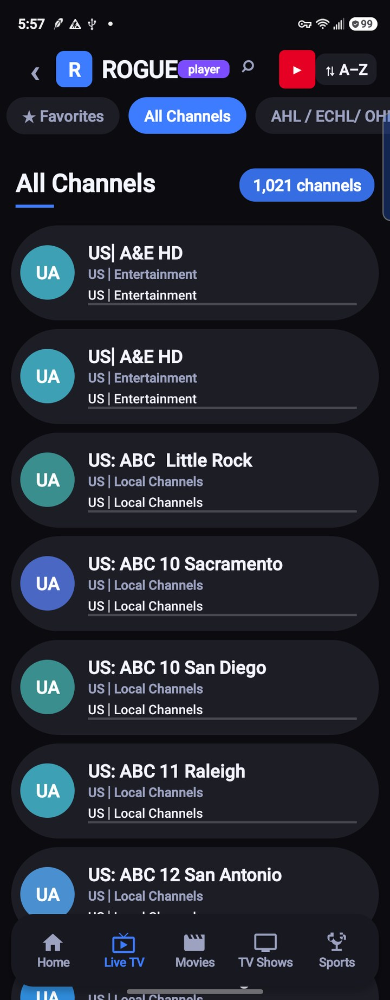</a> Live TV categories | <a href="docs/screenshots/phone/03-live-channels.jpg">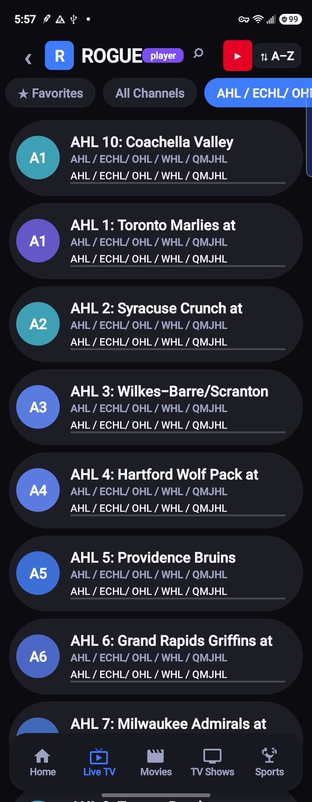</a> Channels in a category |
| <a href="docs/screenshots/phone/04-guide.jpg">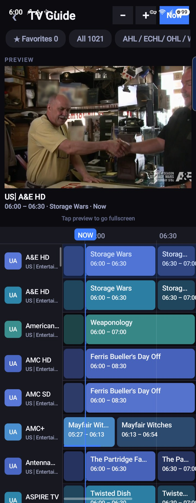</a> EPG guide |  Movie categories | <a href="docs/screenshots/phone/06-movies-grid.jpg">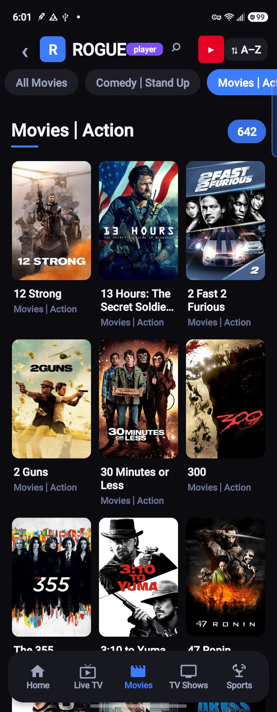</a> Movie grid |
| <a href="docs/screenshots/phone/07-movie-detail.jpg">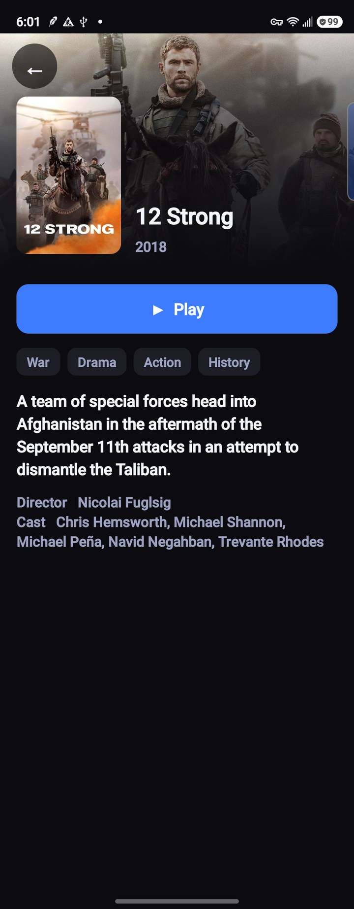</a> Movie detail page |  Series categories | <a href="docs/screenshots/phone/09-folders.jpg">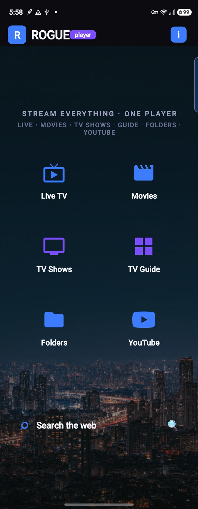</a> Device folders |
| <a href="docs/screenshots/phone/10-settings.jpg">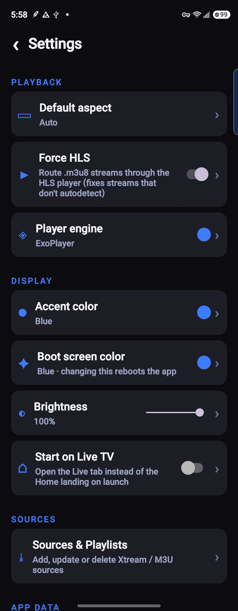</a> Settings | <a href="docs/screenshots/phone/11-playlists.jpg">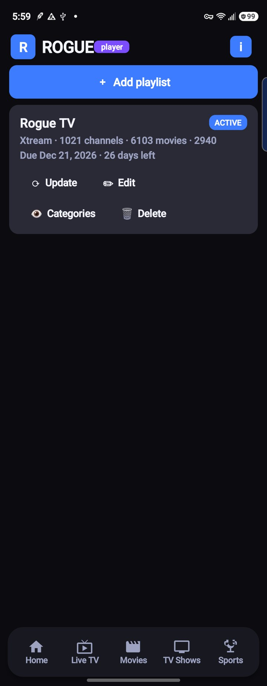</a> Sources & playlists | <a href="docs/screenshots/phone/12-add-playlist.jpg">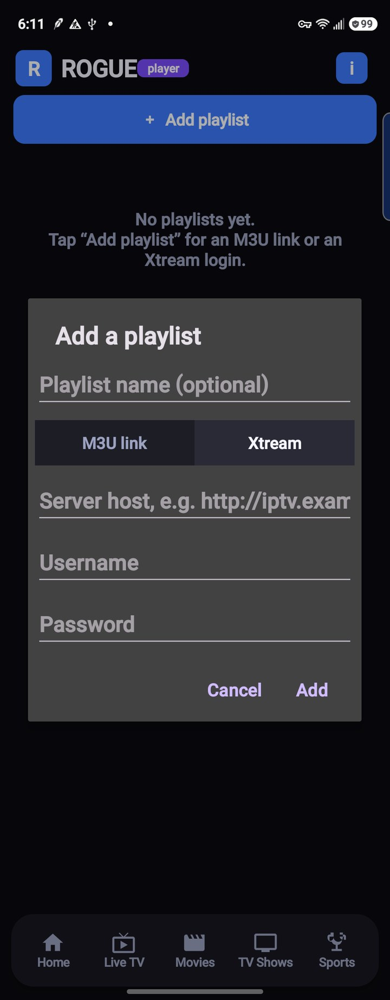</a> Add a playlist |
| <a href="docs/screenshots/phone/13-sports.jpg">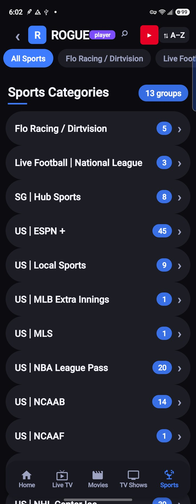</a> Sports |  Player |  |

### Android Auto

|   |   |
|---|---|
| <a href="docs/screenshots/car/01-landing.jpg">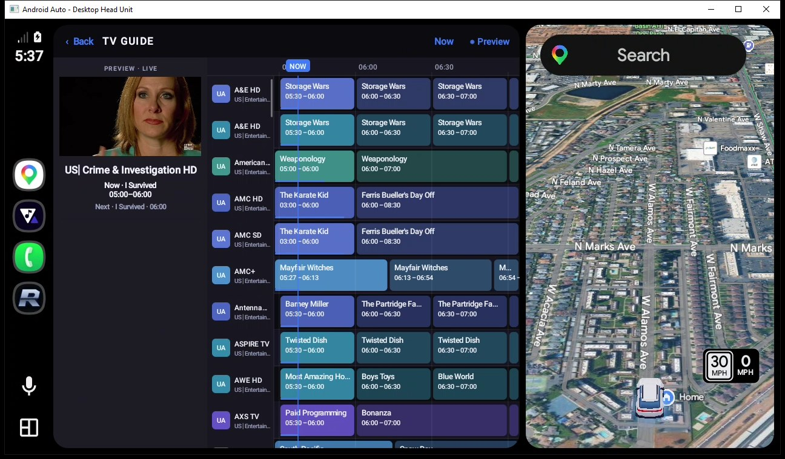</a> Car landing | <a href="docs/screenshots/car/02-movie-groups.jpg">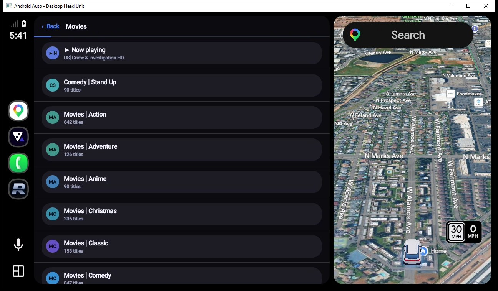</a> Movie categories |
| <a href="docs/screenshots/car/03-poster-grid.jpg">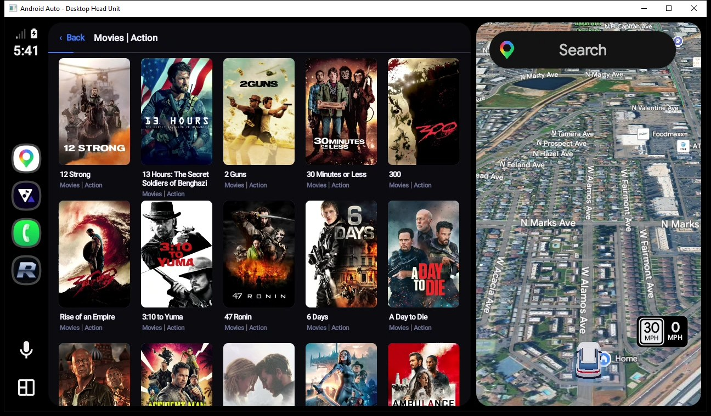</a> Poster grid | <a href="docs/screenshots/car/04-movie-detail.jpg">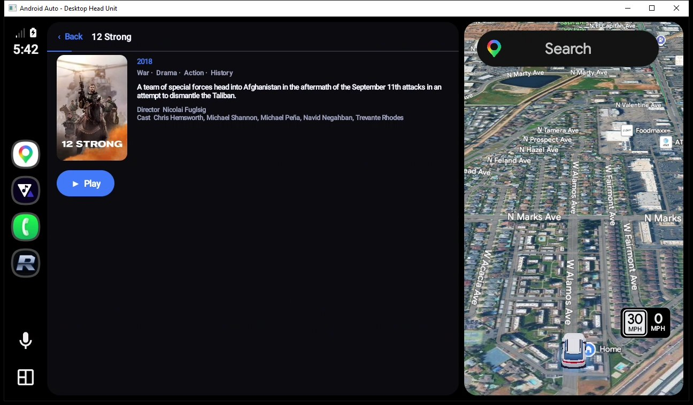</a> Movie detail |
| <a href="docs/screenshots/car/05-shows.jpg">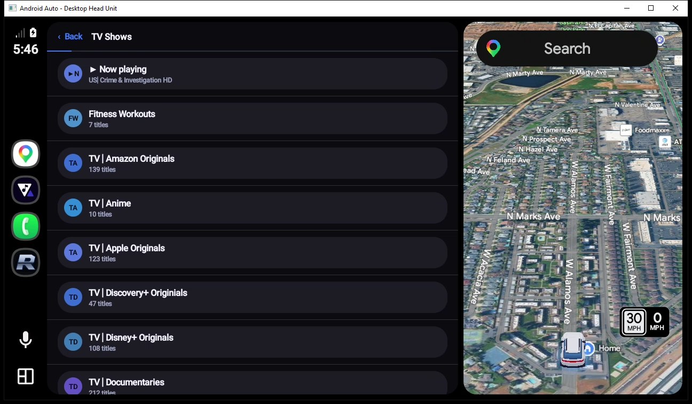</a> Series categories | <a href="docs/screenshots/car/06-show-posters.jpg">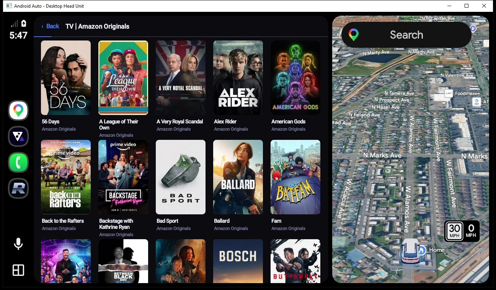</a> Series posters |
| <a href="docs/screenshots/car/07-series.jpg">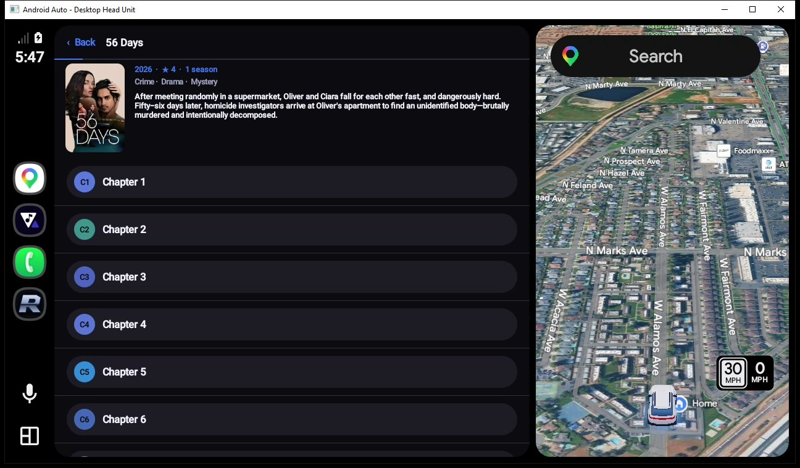</a> Episodes | <a href="docs/screenshots/car/08-player.jpg">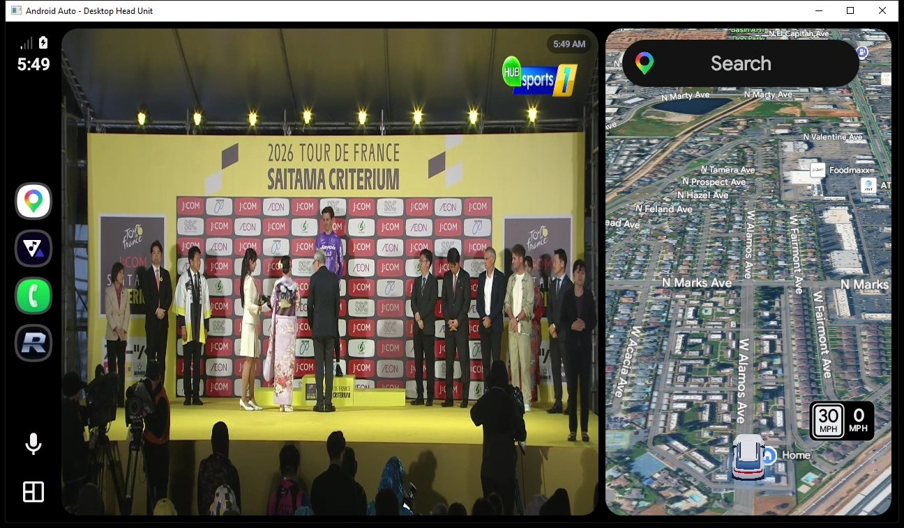</a> Video page |

## Why it's built this way

The car is the reason. Most TV-first players (TiviMate, IMPlayer, IBO Player) don't run in
Android Auto at all. The car-capable ones come with trade-offs I didn't want to live with —
extra portal formats and add-ons in one case, ads in the other.

So this is the smaller thing that was missing for me: a clean, ad-free player that opens my
own subscription on the phone and on the car screen, with a UI I designed rather than
borrowed.

Where the others do more, they genuinely do more — broader portal support, Plex, internet
radio, Stremio add-ons, catch-up, scheduled recording. None of that is here and none of it is
planned. This covers live TV, VOD and series from one subscription, an EPG guide, and the car.

---

## What it does

- **Live TV** — M3U + Xtream Codes sources, category chips, per-source ordering.
- **Movies & Series** — poster grids, detail pages with cast and synopsis, episode lists.
- **EPG guide** — full programme guide with a karaoke-style progress line: the programme
  text fills with the accent colour as it airs, and a thin underline keeps advancing to the
  end of the show.
- **Sports** — auto-detects sport categories (NBA, NFL, ESPN, UFC, F1, …) and scores that
  resolve a game to the channel showing it.
- **Category management** — hide/show categories and reorder them; the order is saved per
  source and drives the chips on every tab.
- **Recording** — one-tap recording of the live channel you're watching. HLS segments are
  copied byte-for-byte into `Movies/Recordings/` — no re-encode, no CPU cost, picture
  untouched. Partial files are kept.
- **Folders** — the phone's own video library, playable in the app.
- **Web browsing + YouTube** — an in-app browser, phone and car.
- **Ad and tracker blocking** — in that browser, on the phone and in the car: ad and tracker
  requests are refused on-device before they leave (`AdBlock.kt`: doubleclick, googlesyndication,
  the ad paths on youtube.com), with a small script on top that hides masthead slots and clicks
  Skip Ad. No proxy, no VPN. It cannot strip an ad muxed into a video stream — and the player
  itself never shows ads, because your own streams don't carry them.
- **Android Auto** — a real car UI: six tiles, a guide with a preview rail, scores, and a
  video page with a transport strip. Two backs on the landing stop playback and end the
  process, so nothing keeps a provider connection open.
- **Own design** — pills, karaoke progress, native boot screen. Not a reskin.

---

## Builds

One codebase, three builds. What gets baked in — not a branch — decides what the login offers:

| build | command | baked in | login offers |
|---|---|---|---|
| **public** (this repo's release) | `gradlew assembleLegacyRelease` | nothing | M3U + Xtream |
| **customer** | `gradlew assembleLegacyRelease -PwithPanel` | the panel address | M3U + Xtream + Rogue TV, where the customer types only their username and password |
| **owner** | `gradlew assembleLegacyRelease -PwithPanel -PwithAccount` | the address and one login | the same three, seeding itself |

Every release build also drops a named copy in `dist/` — `rogue-public-<ver>.apk`,
`rogue-customer-<ver>.apk`, `rogue-owner-<ver>.apk` — because all three otherwise write the same
`app-legacy-release.apk`, and a filename that can't disagree with its contents is cheaper than
remembering.

`baked.properties` and `keystore.properties` are gitignored, so a clone can only produce the
public build. `-PappId=` gives a build its own package so it installs alongside another.
`versionCode` is the git commit count; `versionName` is `1.0.<count>`.

---

## Requirements

- Android 10 (API 29) or newer, **arm64** — 32-bit devices can't install it.
- Your own M3U link or Xtream login. Nothing else.

## Install

1. Copy the APK to the phone and tap it. Android will ask once to allow installs from that
   app ("Install unknown apps") — allow it, then install. `adb install <file>.apk` works too.
2. Open the app → **Add playlist** → M3U link, or Xtream with your server, username and
   password.
3. That's the whole install. **Android Auto needs nothing extra:** the car app appears
   because the phone app declares the Android Auto categories, so the same APK you installed
   on the phone is what shows on the head unit. No third-party installer, nothing to side-load
   into the car.

If the car app doesn't appear immediately, unplug and re-plug the phone, or restart the phone
once after the first install.

If the device refuses the APK — the installer says it can't install, or nothing happens after
tapping it — use **KingInstaller** to push the same file. Nothing needs rebuilding for that: it is
the system installer being picky, not the APK.

---

## License

GPL-3.0-or-later. See [LICENSE](LICENSE).

In plain terms: use it, change it, ship it — but if you distribute a modified version, its
source has to be available under the same license.

---

## Disclaimer

Rogue Player is a **player only**. It does not provide, host, sell or distribute any
channels, playlists, streams or copyrighted media. You must add your own source and have the
legal right to access it. Android Auto video/IPTV is not officially supported by Google —
running this in a car requires sideloading, is done at your own risk, and only when parked.
